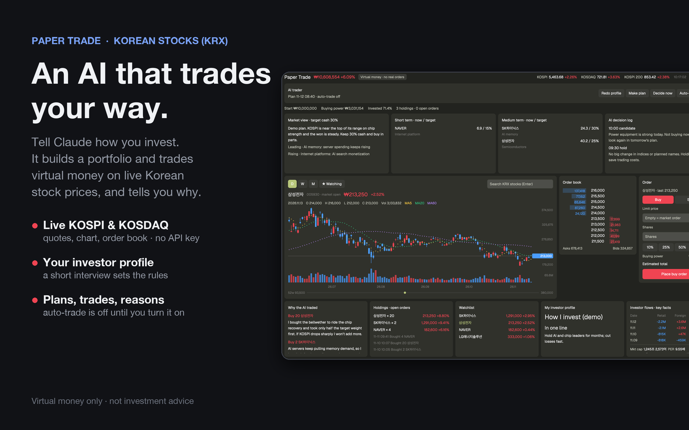

# Paper Trade for Herdr: Korean stocks (KOSPI / KOSDAQ)

**An AI paper trader for Korean stocks.** Tell an AI how you invest; it writes your investor profile, builds a portfolio from it, and trades 10,000,000 KRW of virtual money on live KOSPI and KOSDAQ prices, explaining every trade in plain words. No broker account, no API key, no real money.



## What you get

- **A trading desk in one panel**: live quotes, candle chart with moving averages, order book, key facts and investor flows, an order form, holdings and a watchlist.
- **An AI that trades your way**:
  1. **Set up profile**: Claude interviews you (holding period, loss tolerance, position size, sectors, how you pick stocks) and writes `investor_profile.md`. Limits the engine enforces go to `strategy.json` and `rules.json`.
  2. **Make plan**: Claude scans the whole market and builds a short- and medium-term portfolio from your profile. The engine checks position limits, excluded names and financial bars before the plan takes effect. Takes 10-40 minutes.
  3. **Decide now** or **Auto-trade**: during the regular session (weekdays 09:00-15:30 KST) Claude holds, buys or sells against the plan and logs why. Auto-trade is off by default; when on, it runs about every 30 minutes.
- **Manual trading** too: click a price in the order book to use it as a limit. Orders fill only during the regular session.

The panel is in English. Stock names come from the market data and are in Korean. Claude talks to you in whatever language you write in.

## Install

Ask your Herdr agent:

```
Add the paper-trade mod from github.com/dotoridot/paper-trade
```

Or copy `paper-trade/mods/paper-trade` into `~/.config/herdr-app/mods/` and open it:

```sh
herdr-app check ~/.config/herdr-app/mods/paper-trade
herdr-app do tab.new --name "Paper Trade" --mod paper-trade
```

Requirements:

- `python3` (standard library only) and `bash`
- For the AI features, a signed-in [Claude Code](https://claude.com/claude-code) CLI (`claude`). Manual trading works without it.

## Where the prices come from

No sign-up or key is needed. `engine/paper.py` reads the public JSON endpoints that Naver Finance's own web and mobile pages use:

| Data | Endpoint |
| --- | --- |
| Live price, indices | `polling.finance.naver.com/api/realtime/domestic/...` |
| Daily, weekly, monthly candles | `api.stock.naver.com/chart/domestic/item/<code>/<tf>` |
| Order book, key facts, investor flows | `m.stock.naver.com/api/stock/<code>/askingPrice`, `/integration` |
| Financials, news, themes, search | `m.stock.naver.com/api/...`, `front-api/search/autoComplete` |

These are not an official API, so they can change or be blocked without notice. When a request fails, the panel keeps the last data and says so.

## Good to know

- **Not investment advice.** The AI can be wrong, and paper results promise nothing about real returns.
- The AI features use your own Claude plan. One plan run makes dozens of tool calls.
- Korean market only: KOSPI and KOSDAQ stocks, prices in KRW, the regular KRX session. Fees (0.015%), the sell tax (0.20%) and market-order slippage (0.05%) are simulated. Want the US market or another country? See [docs/OTHER_MARKETS.md](docs/OTHER_MARKETS.md).
- The panel runs `python3`, `bash` and `claude` and reaches the network. It writes only to `~/.paper-trade` (or `$PAPER_HOME`).
- Pick a Claude model with `PAPER_MODEL`; otherwise your `claude` default is used.

## From a terminal

The engine works without the panel:

```sh
E=~/.config/herdr-app/mods/paper-trade/engine
python3 -I $E/paper.py search hynix
python3 -I $E/paper.py buy 000660 1 --limit 1300000
python3 -I $E/paper.py status
bash $E/run.sh onboard      # profile interview
bash $E/run.sh plan         # build the plan
bash $E/run.sh decide       # one decision
bash $E/run.sh start plan   # plan in the background
```

Tests: `cd $E && python3 -m unittest test_paper`

## Layout

```
docs/OTHER_MARKETS.md    how to adapt it to the US or another market
paper-trade/
  RECIPE.md              brief another agent can rebuild this panel from
  preview.png
  mods/paper-trade/
    main.js, mod.json    the Herdr panel
    engine/paper.py      quotes, ledger, fills, plan checks
    engine/run.sh        AI runner (claude CLI)
    engine/prompts/      profile interview, plan and decision prompts
    engine/test_paper.py
```

## 한국어 안내

가상 자금 1,000만 원으로 국내 주식을 실시간 시세에 사고파는 Herdr 패널입니다. "Set up profile"을 누르면 Claude가 투자 성향을 묻고(한국어로 답하면 한국어로 진행), 그 성향대로 포트폴리오를 짜고 장중에 매매하며 이유를 남깁니다. 한국 시장(코스피, 코스닥, 원화, KRX 정규장) 기준이며, 시세는 네이버 증권 공개 JSON에서 받아 별도 인증이 필요 없습니다. 미국이나 다른 나라 시장으로 바꾸려면 [docs/OTHER_MARKETS.md](docs/OTHER_MARKETS.md)를 참고하세요. 투자 권유가 아닙니다.

## License

MIT
