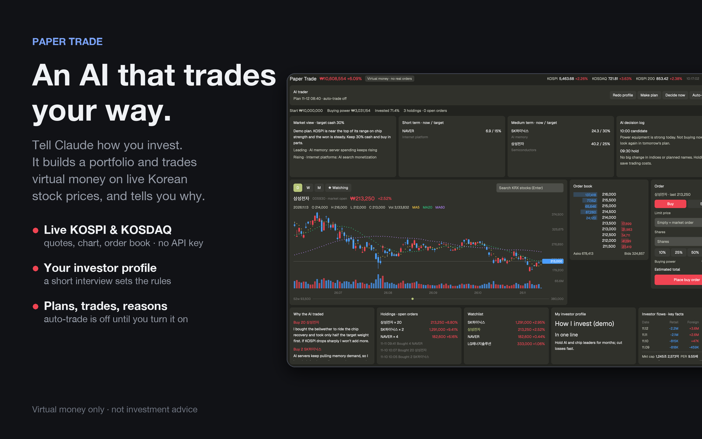

# Paper Trade

An AI paper trader for Korean stocks in one Herdr panel. You start with 10,000,000 KRW of virtual money, watch live KOSPI and KOSDAQ quotes, a candle chart and the order book, and place orders that fill against real prices. An AI you shape interviews you about how you invest, writes your investor profile, builds a short- and medium-term portfolio from it, and (if you turn it on) trades the account about every 30 minutes during market hours, explaining each trade in plain words. No broker, no API key, no real money.

## What you see

One mod, `paper-trade`, filling a tab, a pane or a dialog. The interface is in English; stock names come from the data in Korean. Colors follow the Korean convention: up is red `#f04452`, down is blue `#4a9dff`. All other colors come from `theme()`.

Top to bottom, 10px padding, 8px gaps, cards are `surface` with 8px radius:

1. **Header row**: "Paper Trade", account value and return (red/blue), a "Virtual money · no real orders" pill; on the right the KOSPI, KOSDAQ and KOSPI 200 ticker, the quote time and a Refresh button.
2. **AI bar** ("AI trader"): a status line and four buttons: Set up profile (or Redo profile), Make plan, Decide now, Auto-trade on/off. While the AI works, a braille spinner (`frames`, 90ms) and "Planning · since 14:02" in the `working` color. Buttons that can't run yet are drawn at 45% opacity and explain why when clicked.
3. **Account line**: start money, buying power, invested %, number of holdings and open orders.
4. **Plan row** (200px high): Market view (the AI's summary and target cash), Short term and Medium term (each name with current / target weight), AI decision log (one entry per decision, failures in `blocked`).
5. **Trading row**: the chart card (D/W/M switch, ☆ Watch toggle, a search box; 110 candles with 5/20/60-day moving average dots, volume bars, price axis, a hover O/H/L/C readout, a 52-week range bar), the Order book (258px; click a level to use it as the limit price) and the Order form (236px; Buy/Sell, limit, shares, 10/25/50/Max buttons, estimated total).
6. **Bottom row** (186px): Why the AI traded (its plain-language reason per trade), Holdings · open orders (click to chart, Cancel), Watchlist, My investor profile (the profile as markdown), Investor flows · key facts (5 days of retail/foreign/institution net buying, market cap, PER, PBR, EPS, dividend yield, foreign ownership).

## How it behaves

- Every 60 seconds it reloads the account and the market board. During the regular KRX session (weekdays 09:00 to 15:30 KST) it first runs `tick`, which fills open orders at live prices and applies the stop-loss rules.
- Set up profile opens a new tab running `claude` with an interview prompt. Claude asks 7 to 10 questions one at a time, in the language the user writes in, and writes `investor_profile.md`, `strategy.json` and `rules.json` in `~/.paper-trade`.
- Make plan runs `run.sh start plan`. Claude reads the profile, scans the market through the engine, writes `portfolio.draft.json`, and the engine checks it against `strategy.json` before it becomes the plan. Takes 10 to 40 minutes.
- Decide now runs one decision (`run.sh start decide`): hold, buy, sell or note a candidate, always ending with a journal entry. Outside the regular session it does nothing; Naver reports `marketStatus: OPEN` during after-market trading too, so the engine also checks the clock.
- Auto-trade is off by default. When on (remembered in `localStorage`), each copy of the panel asks for `run.sh start auto` at most every 30 minutes during market hours; `run.sh` starts a decision only if 25 minutes have passed since the last automatic one (`~/.paper-trade/last-auto`) and otherwise answers `{"skipped": "auto"}`, so several open copies never double up or show a spinner for nothing.
- Only one AI job runs at a time (`~/.paper-trade/ai-running`). `run.sh start` checks for `claude`, the profile or the plan before detaching and reports the reason at once.
- Orders placed by hand are `source: user`. Inside AI runs `run.sh` sets `PAPER_SOURCE=ai`, so every order the AI places is an AI order even without `--source ai`. The engine refuses AI buys before 09:30, on days KOSPI is down 2% or more, the day after a +10% jump, and on holdings at a loss; the limits come from `strategy.json`.

## Built from

- `mods/paper-trade/main.js`: one `View`. Uses `exec`, `run("tab.new", { name, argv })`, `appHome`, `theme`, `localStorage`, `cx.timer.every`, `TextView.markdown`, `InputState`/`Input`. `mod.json` is `{ "place": "none" }`; open it with `tab.new { name: "Paper Trade", mod: "paper-trade" }`.
- `mods/paper-trade/engine/paper.py`: Python 3 standard library only. Commands the panel calls: `status`, `board`, `view SYM --tf day|week|month --count 200`, `search TEXT`, `buy|sell SYM QTY [--limit P] --source user`, `cancel ID`, `watch add|rm SYM`, `tick`. Prints JSON. Quotes, charts, order books, finance, news and themes come from Naver Finance's public JSON endpoints (`polling.finance.naver.com`, `m.stock.naver.com`, `api.stock.naver.com`); no key or login.
- `mods/paper-trade/engine/run.sh`: `onboard` (interactive claude), `plan`, `decide`, `auto`, and `start plan|decide|auto` (detaches with `nohup bash`, because `exec` has a 30-second limit). Claude runs with `~/.paper-trade` as its working folder and may read only there, edit only its own output file, and run only named engine commands: lookups (`quote`, `fin`, `news`, `theme`, `search`, `chart`, `status`) in every stage, `pulse`, `macro` and `plan` while planning, and `buy`, `sell`, `journal` only while deciding.
- `mods/paper-trade/engine/prompts/`: `onboard.md`, `plan.md`, `decide.md`, in English, with `{{ENGINE}}` and `{{HOME}}` filled in by `run.sh`. Claude answers in the user's language.
- `mods/paper-trade/engine/test_paper.py`: 58 unit tests, `python3 -m unittest test_paper` from the engine folder.

## Watch out

- The panel runs programs: `python3` (the engine) and `bash run.sh`, which runs the `claude` CLI and uses the person's Claude plan. It reaches the network (Naver Finance). It reads and writes only `~/.paper-trade` (or `$PAPER_HOME`).
- Naver Finance endpoints are unofficial and can change or block requests without notice. When one fails the panel keeps the last data and says so.
- Korean stocks only. Prices are KRW; fees (0.015%), sell tax (0.20%) and market-order slippage (0.05%) are simulated.
- Naver's field names are Korean (`시총`, `52주 최고`, `영업이익`); the code keeps them as lookup keys and shows English labels.
- If the folder is renamed, change `MOD` at the top of `main.js`, since the engine path is `appHome()/mods/<MOD>/engine`.
- `exec` gives 30 seconds; anything longer must go through `run.sh start`.
- The engine never writes inside the mod folder, so saving data doesn't hot-reload the panel.
- Needs `python3` (standard library only), `bash` and, for the AI parts, the `claude` CLI signed in. Without `claude`, manual trading still works.

## Done when

- `herdr-app check ~/.config/herdr-app/mods/paper-trade` passes.
- `python3 -m unittest test_paper` in `engine/` passes.
- The panel shows a ₩10,000,000 account, the index ticker and a chart for SK하이닉스 (000660) on first open.
- Searching "삼성" lists 삼성전자; buying 1 share during market hours fills and appears under Holdings · open orders.
- Set up profile opens a tab with claude asking the first question; after it finishes, My investor profile shows the profile and Make plan becomes active.
- Make plan shows the spinner, and later the plan row fills with names and target weights.
